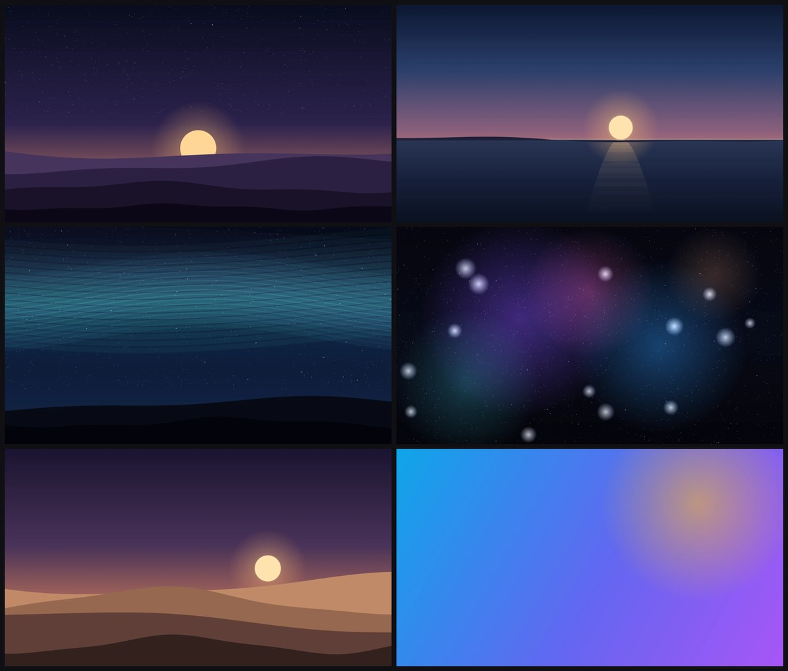
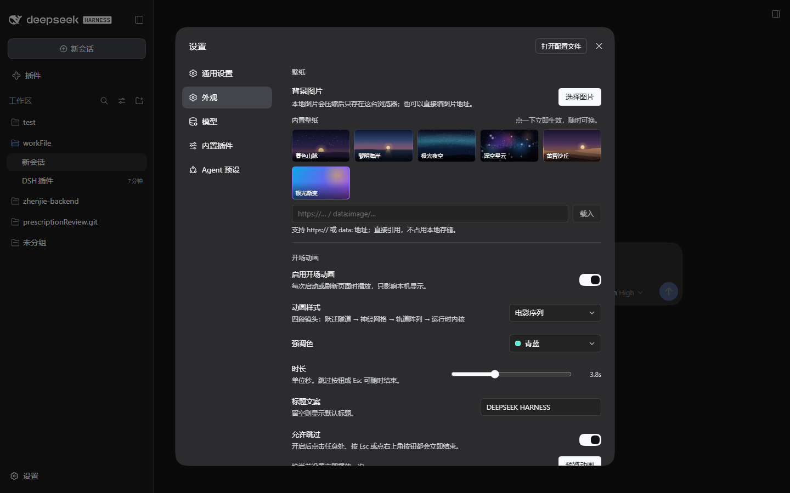
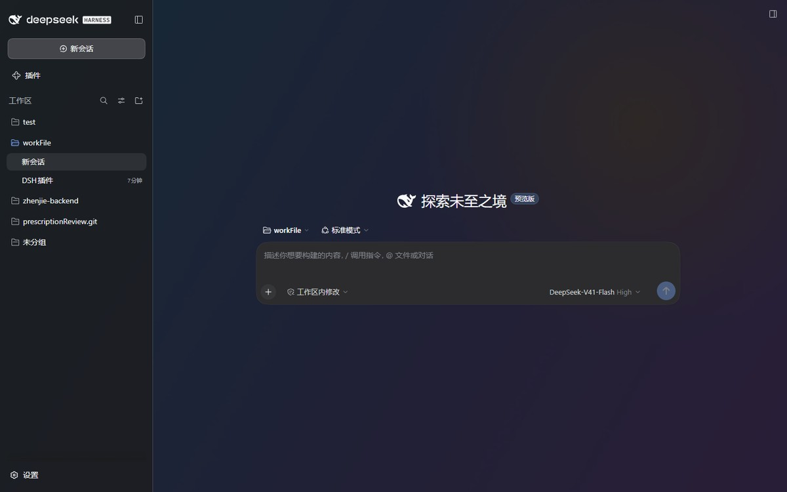

# 外观（壁纸 + 开场动画）

DeepSeek Harness 的 Web UI 外观插件：在**设置 → 外观**里管理窗口壁纸和每次启动/刷新时的开场动画。

- 壁纸：本地图片、图片 URL，或六张**内置壁纸**（暮色山脉 / 黎明海岸 / 极光夜空 / 深空星云 / 黄昏沙丘 / 极光渐变）；可缩放、拖拽取景；界面外壳变成半透明磨砂，卡片与弹窗保持不透明。
- 开场动画：全屏启动封面，四种预设、四种强调色、可调时长、可改标题、可关闭跳过。
- 控件：下拉菜单与开关自绘，颜色跟随主题 token，深色主题下不会闪出系统白底弹层。

两件事都只在本机生效，不写 Host 状态、不联网。

## 安装

从 GitHub 安装（推荐）：

```powershell
dsh plugin --profile desktop add github:zhaohzXo/dsh-appearance
```

或安装本地目录：

```powershell
dsh plugin add "D:\workFile\my\dshP\dsh-appearance"
```

也可以在本 GUI 的插件管理里安装目录 `D:\workFile\my\dshP\dsh-appearance`。
安装后**刷新页面或重启应用**一次即可看到「设置 → 外观」。

## 用法

设置面板左侧导航新增一页 **外观**（位于「通用」与「模型」之间）：

| 分组 | 项目 | 说明 |
| --- | --- | --- |
| 壁纸 | 内置壁纸 | 六张现成壁纸，点缩略图立即生效；当前选中的那张有高亮描边 |
| 壁纸 | 背景图片 | 选本地图片压缩后存本地；已选时可「更换 / 移除」 |
| 壁纸 | 图片链接 | 粘贴 `https://…` 或 `data:image/…`，回车或点「载入」直接取用，适合壁纸站直链 |
| 壁纸 | 取景（缩略图区） | 在缩略图上按住拖动改变取景位置，滚轮缩放，双击回到居中 100% |
| 壁纸 | 缩放 | 100–250%，超出容器的部分才能拖动取景 |
| 壁纸 | 遮罩强度 | 30–92%，越高壁纸越淡、文字越清晰（深色主题下可适当调低） |
| 开场动画 | 启用开场动画 | 关闭后启动不再播放 |
| 开场动画 | 动画样式 | 电影序列 / 极光流带 / 星域网络 / 极简光环 |
| 开场动画 | 强调色 | 青蓝 / 紫罗兰 / 琥珀 / 翡翠（同时改变封面与 canvas 粒子） |
| 开场动画 | 时长 | 1.5–8.0 秒；电影序列会把四段镜头均分到该时长 |
| 开场动画 | 标题文案 | 封面主标题，留空回退 `DEEPSEEK HARNESS` |
| 开场动画 | 允许跳过 | 开启时点击任意处、按 `Esc`、点右上角按钮都能立即结束 |
| 开场动画 | 预览动画 | 按当前设置立刻播放一次（不改动存储） |

下拉菜单与开关都是自绘的（原生 `<select>` 的弹层由系统绘制，深色主题下会闪出白底，这也是本插件不用它的原因）：菜单位置按视口空间自动上下翻转、跟随面板滚动，颜色全部取自主题 token。

四种预设：

- **电影序列**：四段镜头 —— 跃迁隧道 → 神经网格 → 轨道阵列 → 运行时内核，每段切换场记与粒子行为。
- **极光流带**：缓慢流动的叠加光带，最安静。
- **星域网络**：漂浮星点 + 近邻连线。
- **极简光环**：只有光环、进度条与文字，最省电。

## 内置壁纸

六张，都不带图片文件：按预设参数用 canvas 现画 2400×1350，再走和本地图片相同的那条路径压成 WebP 存进 `dsh.appearance.image.v1`（实测 20–115 KB），所以分辨率越高越清晰、包体不变大。

| 预设 | 画面 |
| --- | --- |
| 暮色山脉 | 靛蓝夜空 + 暖色地平线、落日、四层山脊与星点 |
| 黎明海岸 | 桃金渐变天光、海平线、水面反光带与远岬 |
| 极光夜空 | 三层极光帷幕（青绿 / 冰蓝 / 紫）、星空、黑色山脊 |
| 深空星云 | 紫 / 蓝 / 品红星云团、尘埃带、带光晕的亮星 |
| 黄昏沙丘 | 暖橙天光、低角度落日、四层沙丘曲线 |
| 极光渐变 | 蓝→靛→紫对角渐变 + 琥珀光晕，最安静 |

内置壁纸和本地图片共用取景、缩放、遮罩；当前选中的是哪张记在 `background.preset`（换成本地图或 URL 时自动清空），刷新后高亮仍在。

## 实现

- `client.js`：Client 半边。设置页注册到 `settings.section`（`id: appearance`, `order: 5`）；壁纸通过 `theme.overrideTokens()` 覆盖 `--dsw-alias-bg-base` 与 `--dsw-specific-sidebar-fill`，让外壳透出 `document.body` 的背景图；开场动画是模块求值时立刻挂载的全屏封面（自有 DOM + canvas + 定时器，结束即自毁），来自仓库 `packages/client/web/src/boot-intro.ts` 的实现思路与样式，改为可配置、可换色、多预设。
- `src/client.template.js`：可读源码，`__INTRO_CSS__` 为样式占位符。
- 控件配色只用语义 token：填充按钮 = `--dsw-alias-button-primary-fill` + `--dsw-alias-label-primary-foreground`，开关 = `--dsw-alias-brand-primary` + `--dsw-alias-switch-thumb`。`brand-primary` 在深色主题下是**近白**墨色，若配 `#ffffff` 文字或圆点就会变成“一片白”。
- `src/intro.css`：由上游 `boot-intro.module.css` 机械转换而来（类名加 `dshfx-` 前缀、颜色改为 `--fx-*` 变量以支持强调色）。
- 内置壁纸：`drawDusk / drawDawn / drawAurora / drawNebula / drawDunes / drawGradient` 六个 canvas 绘制函数，配合 `seeded()` 固定随机种子，同参数每次渲染完全一致；缩略图在挂载时（`React.useMemo`）以 320×180 画一次。
- `build.mjs`：把样式拼进模板，生成 `client.js`。改完 `src/` 后运行：

```powershell
cd D:\workFile\my\dshP\dsh-appearance
node build.mjs
```

- `index.js`：Host 半边，空实现，只为提供 Loader 行。
- `locale/*.json`、`icon.svg`：插件管理里的标题、描述与图标。

## 存储

| Key | 内容 |
| --- | --- |
| `dsh.appearance.v1` | 配置（遮罩、缩放、取景位置、图片尺寸、内置壁纸 key、开场动画各项），体积很小 |
| `dsh.appearance.image.v1` | 壁纸内容（本地图片为 WebP data URL；URL 壁纸则存该 URL，≤2.4 MB） |

旧版 `dsh.background.v1` 会在首次读取时自动迁移。壁纸与配置分离存放：拖取景、拉缩放只重写几十字节的配置，不会重写整张图片。

## 截图

| 六张内置壁纸 | 设置 → 外观（深色） |
| --- | --- |
|  |  |

| 开场动画 | 应用壁纸后的主界面 |
| --- | --- |
|  |  |

## 已知限制

- 壁纸与动画配置属于浏览器本地，不跟随账号同步，换 profile 或清除站点数据即丢失。
- 壁纸尺寸按 `cover × 缩放` 计算：知道原图宽高时用像素，未知时回退 `百分比 × auto`（拖拽换算按近似比例）。
- 外壳底色依赖 `--dsw-alias-bg-base` 与 `--dsw-specific-sidebar-fill` 两个 token；若上游改名需同步调整 `wallpaperTokens()`。
- 取景位置只在图片大于容器时才有拖动空间；双击缩略图可随时回到居中 100%。
- 动画在模块求值时开始，若宿主把插件脚本推迟到首屏之后才加载，封面会晚一点出现（时长仍按配置走）。
- `prefers-reduced-motion` 下自动降级为静态封面。
